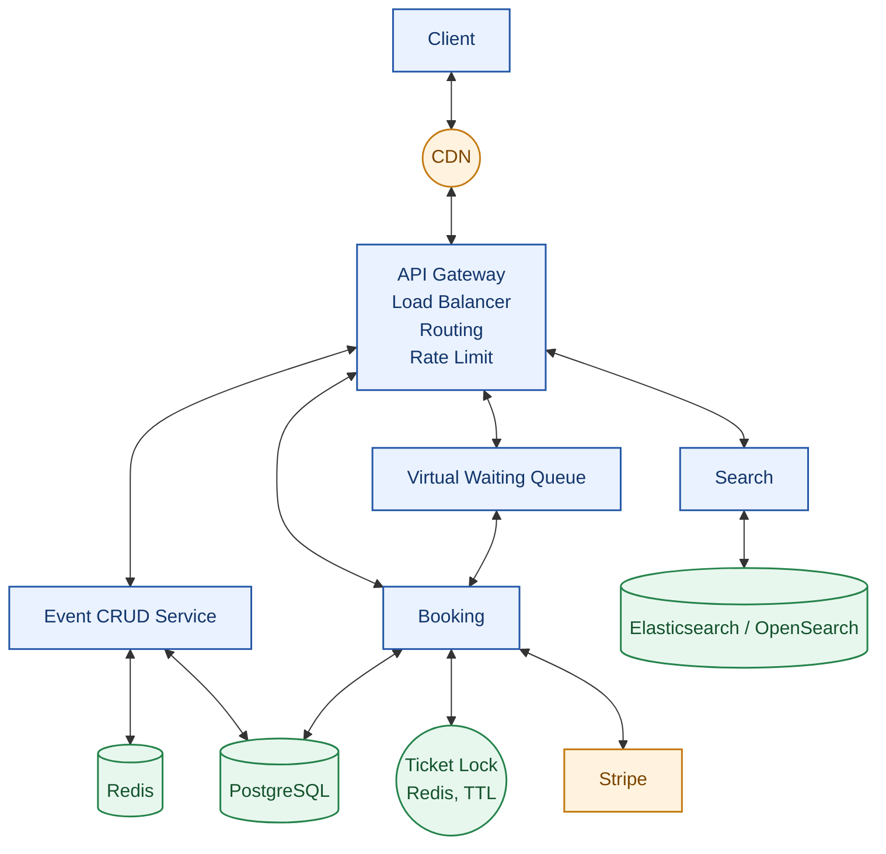

## System Architecture

### Components

- **Client:** User-facing application.
- **CDN:** Caches and delivers static content.
- **API Gateway:** Handles load balancing, request routing, and rate limiting.
- **Search:** Finds events using Elasticsearch/OpenSearch.
- **Event CRUD Service:** Creates, reads, updates, and deletes event information.
- **Virtual Waiting Queue:** Manages traffic during high-demand ticket sales.
- **Booking:** Handles ticket reservations and booking workflows.
- **PostgreSQL:** Stores persistent event and booking data.
- **Redis:** Supports caching and fast data access.
- **Ticket Lock:** Uses Redis with a TTL (time to live) to temporarily reserve tickets and help prevent double booking.
- **Stripe:** Processes payments.

### Booking Flow

1. The client sends a request through the CDN and API Gateway.
2. The API Gateway routes the request to the appropriate service.
3. The waiting queue controls access during periods of high demand.
4. The Booking service checks ticket availability and acquires a temporary ticket lock.
5. Booking information is stored in PostgreSQL.
6. Stripe processes the payment.
7. The booking is confirmed and the temporary lock is released or expires.

